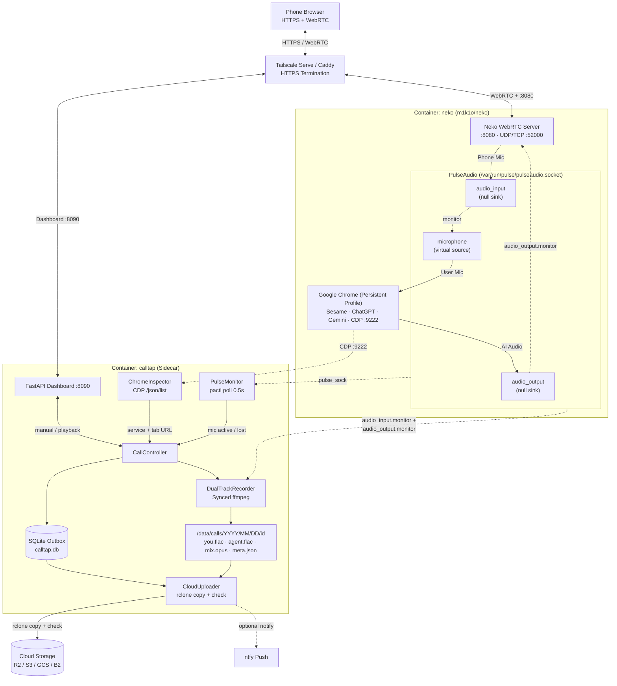
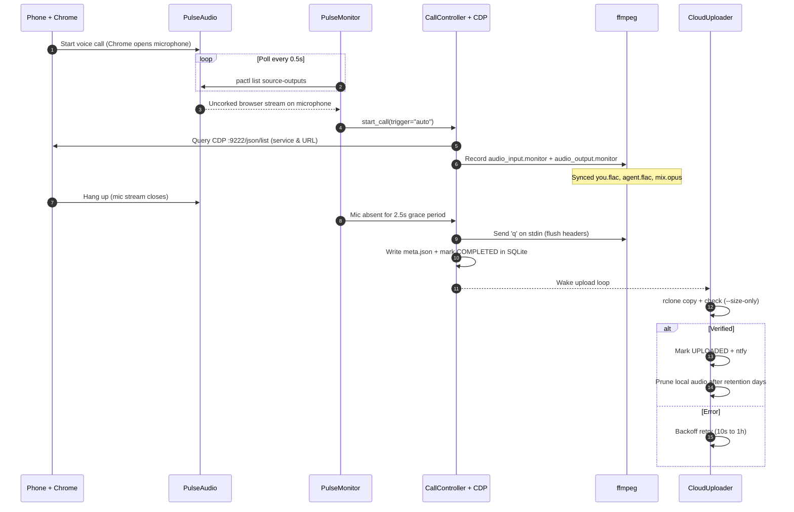

# CallTap

Dual-track voice call recorder and cloud uploader for browser-based AI voice agents (Sesame AI, ChatGPT Voice, Gemini Live, and others), controllable from a phone browser.

## How it works

Web voice agents encrypt media end to end with WebRTC (DTLS-SRTP), so a network proxy cannot inspect audio. CallTap runs a real Chrome browser inside `m1k1o/neko` on your homelab or VPS:

1. Your phone connects to Neko over HTTPS/WebRTC, sends your mic to virtual sink `audio_input`, and hears `audio_output.monitor`.
2. Chrome has persistent login enabled (`--bwsi` removed, cookies allowed, profile mounted on a Docker volume) so your Sesame AI session survives restarts.
3. The CallTap sidecar watches PulseAudio (`pactl list source-outputs`) over a shared unix socket. When Chrome opens `microphone`, one `ffmpeg` process records `audio_input.monitor` (`you.flac`) and `audio_output.monitor` (`agent.flac`) in sync, plus an optional stereo `mix.opus` (left = you, right = agent).
4. After hang-up, CallTap writes `meta.json`, enqueues the call in a SQLite outbox, uploads to R2 / S3 / GCS / B2 via `rclone` with verification, and prunes local audio after `CALLTAP_LOCAL_RETENTION_DAYS`.

### Architecture & Audio Routing



### Auto-Detect Recording & Upload Lifecycle



## Quick start

```bash
cp .env.example .env
cp rclone/rclone.conf.example rclone/rclone.conf
# Edit .env (passwords, CALLTAP_RCLONE_REMOTE) and rclone/rclone.conf
docker compose up -d --build
```

### Connect from your phone

Phone browsers require **HTTPS** to share your microphone.

- **Homelab / VPS with Tailscale (recommended, zero open ports):**
  ```bash
  ./deploy/homelab/tailscale-serve.sh
  ```
  Open Neko on `https://<machine>.<tailnet>.ts.net/` to log in to Sesame AI and make calls, and open `https://<machine>.<tailnet>.ts.net:8443/` for the CallTap dashboard.

- **VPS without Tailscale:**
  Set `NEKO_WEBRTC_NAT1TO1=<your-public-ip>` in `.env`, open TCP `80/443` and UDP `52000`, set `CALLTAP_DASHBOARD_USER`/`CALLTAP_DASHBOARD_PASS`, and point Caddy at `deploy/vps/Caddyfile`.

## Local development & tests

```bash
uv venv --python 3.13 .venv
uv pip install --python .venv/bin/python -e ".[dev]"
.venv/bin/pytest
```
