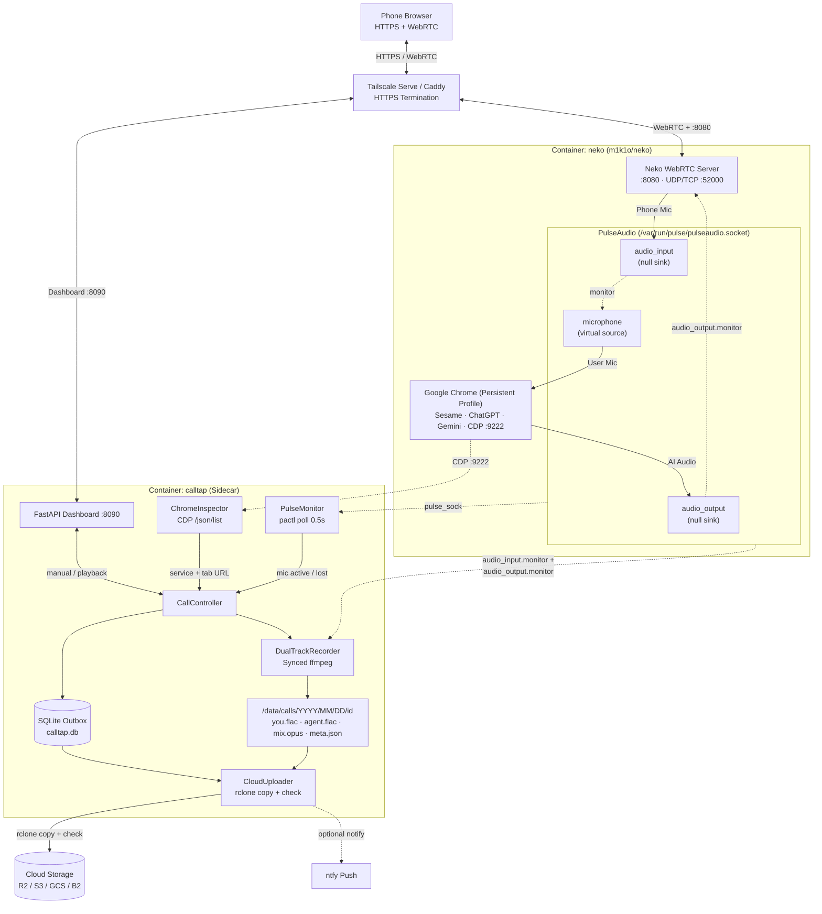
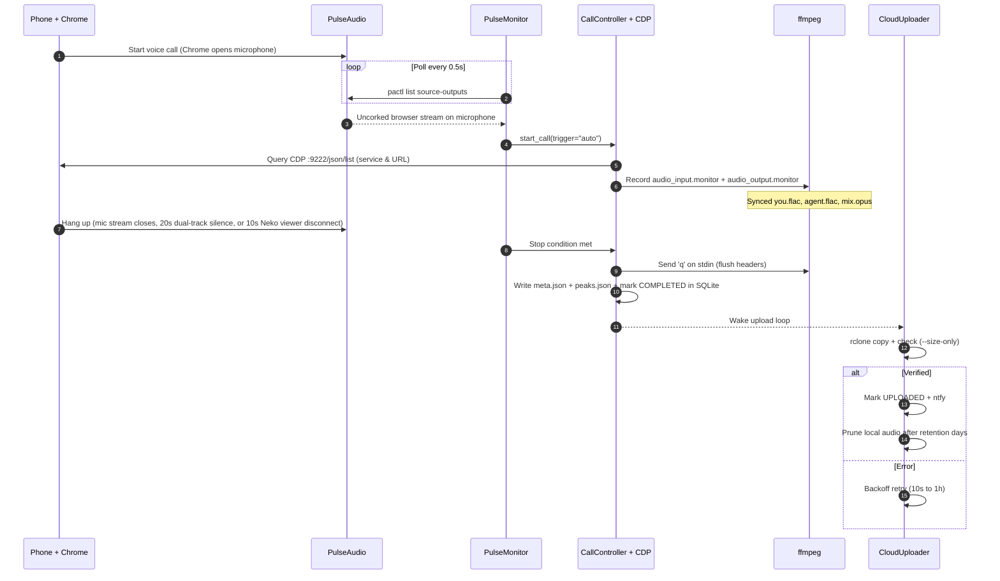
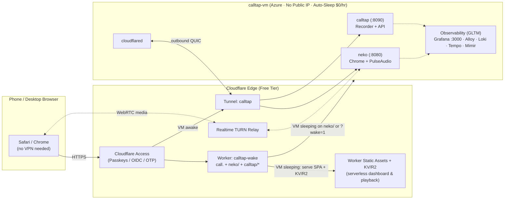

# CallTap

Dual-track voice call recorder and cloud uploader for browser-based AI voice agents (Sesame AI, ChatGPT Voice, Gemini Live, and others), controllable from a phone browser.

## How it works

Web voice agents encrypt media end to end with WebRTC (DTLS-SRTP), so a network proxy cannot inspect audio. CallTap runs a real Chrome browser inside `m1k1o/neko` on your homelab or VPS:

1. Your phone connects to Neko over HTTPS/WebRTC, sends your mic to virtual sink `audio_input`, and hears `audio_output.monitor`.
2. Chrome has persistent login enabled (`--bwsi` removed, cookies allowed, profile mounted on a Docker volume) so your Sesame AI session survives restarts.
3. The CallTap sidecar watches PulseAudio (`pactl list source-outputs`) over a shared unix socket. When Chrome opens `microphone`, one `ffmpeg` process records `audio_input.monitor` (`you.flac`) and `audio_output.monitor` (`agent.flac`) in sync, plus an optional stereo `mix.opus` (left = you, right = agent).
4. After hang-up, CallTap writes `meta.json`, extracts a dual-track waveform (`peaks.json`), and saves locally by default. Optionally connect Cloudflare R2, AWS S3, Backblaze B2, or Google Drive directly inside the dashboard (no `.env` or `rclone.conf` preconfiguration required) with auto-upload or manual upload of selected calls.

### Architecture & Audio Routing



### Auto-Detect Recording & Upload Lifecycle



## Deployment (High-Level View)

CallTap supports three deployment targets under [`deploy/`](deploy/):

| Target | Entry Point | Notes |
|---|---|---|
| **Cloudflare + Azure VM (recommended)** | [`deploy/README.md`](deploy/README.md), [`deploy/cloudflare/README.md`](deploy/cloudflare/README.md) | Zero public IPs, Passkey/OIDC SSO via Cloudflare Access, 1-tap VM wake + 15m auto-sleep (`$0/hr` idle), and serverless dashboard/playback via Worker + KV/R2 while the VM sleeps. |
| **VPS + Caddy** | [`deploy/vps/Caddyfile`](deploy/vps/Caddyfile) | Reverse proxy for `neko` (`:8080`) and `calltap` (`:8090`) on a standard Linux VPS with public ports `80/443` and `52000/udp+tcp`. |
| **Homelab + Tailscale Serve** | [`deploy/homelab/tailscale-serve.sh`](deploy/homelab/tailscale-serve.sh) | Exposes Neko (`:443`) and CallTap (`:8443`) privately over Tailscale HTTPS. |



### Observability (GLTM Stack)

Every Docker Compose deployment runs a built-in **Grafana + Loki + Tempo + Mimir + Alloy** stack ([`deploy/observability/`](deploy/observability/)):

- **Alloy** collects Docker container JSON logs (-> **Loki**), scrapes host + `neko` + `calltap` Prometheus metrics (-> **Mimir**), and ingests OpenTelemetry traces from `calltap` (`:4318`) (-> **Tempo**).
- **Grafana** is exposed at `grafana.<domain>` behind Cloudflare Access (Passkeys) with auto-login via `Cf-Access-Authenticated-User-Email` (and also bound to `127.0.0.1:3000` for SSH tunnels), featuring a pre-provisioned **CallTap & Neko** dashboard.

For full setup, secret locations, deploy commands, and step-by-step troubleshooting runbooks, see **[`deploy/README.md`](deploy/README.md)**.

## Quick start

```bash
cp .env.example .env
# Edit .env (passwords, Cloudflare/Neko settings). No S3/R2 keys required in .env.
docker compose up -d --build
```

Open the CallTap dashboard, click **Local Only** in the top bar whenever you want to connect Cloudflare R2, AWS S3, Backblaze B2 / Custom S3, or Google Drive, test the connection, and choose auto-upload or manual selection uploads.

## Local development & tests

```bash
# Backend + tests
uv venv --python 3.13 .venv
uv pip install --python .venv/bin/python -e ".[dev]"
.venv/bin/pytest
.venv/bin/ruff check calltap tests

# Frontend (React + Tailwind + Vercel Geist)
cd web
npm install
npm run build   # or `npm run dev` with Vite proxy to :8090
```

